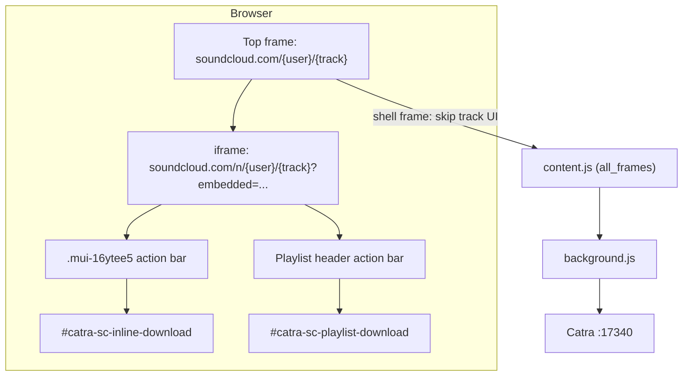

# Catra Chrome Extension

## Overview

Injects download buttons on SoundCloud and YouTube. Track and video downloads POST a canonical URL to Catra. Playlist downloads POST the playlist URL for yt-dlp playlist import.

Load unpacked from `apps/chrome/`.

## SoundCloud architecture



## Injection

### Track pages and track rows

| Step | Behavior |
|------|----------|
| Frame gate | Skip top frame when it embeds an `/n/` track iframe and has no local `mui-16ytee5` |
| Container (new UI) | `.mui-16ytee5` with the most visible `MuiIconButton-root` children |
| Container (classic list) | `.playableTile__actionWrapper` |
| Position | Insert before More (`button[aria-label="More menu"]` or `.sc-button-more`) |
| URL | Strip `/n/` prefix and query params for download (`soundcloud.com/{user}/{track}`) |

### Playlist pages

| Step | Behavior |
|------|----------|
| Container | Header action bar near `h1` with 3-6 SVG action controls |
| Exclusion | Ignore rows that contain `.mui-16ytee5` or an extractable track permalink |
| Position | Append download button to the header action bar |
| URL | Canonical playlist URL (`soundcloud.com/{user}/sets/{playlist}`) |

Shared resilience: 500ms polling, `MutationObserver`, history hooks. Shadow DOM traversal via `collectElementsDeep()`.

## Files

| File | Role |
|------|------|
| `manifest.json` | SoundCloud frame injection and YouTube top-frame injection |
| `src/content.js` | Frame policy, download DOM injection, SPA sync |
| `src/saved.js` | Saved-track cover marks and bounded membership lookups |
| `src/youtube.js` | YouTube video, Shorts, and playlist injection |
| `src/background.js` | Catra API bridge |
| `src/utils.js` | URL normalization |
| `src/styles.css` | Button states and MUI icon sizing |

## Catra API

```http
GET  http://127.0.0.1:17340/health
POST http://127.0.0.1:17340/download
     { "url": "https://soundcloud.com/youcoree/f2f" }
POST http://127.0.0.1:17340/download/playlist
     { "url": "https://soundcloud.com/space-cadet/sets/liberex-003" }
POST http://127.0.0.1:17340/library/saved-tracks
     { "urls": ["https://soundcloud.com/artist/track"] }
     -> { "success": true, "savedUrls": ["https://soundcloud.com/artist/track"] }
```

## Saved SoundCloud covers

- `src/saved.js` runs independently of download controls in each SoundCloud frame. Green check marks indicate tracks saved in Catra; the mark does not intercept pointer events.
- Artwork links and nearby track-title links identify tracks. The main track cover uses its page permalink. Ambiguous rows, artist links and playlist covers are not matched by title.
- Normalize mobile hosts, `/n/` iframe paths, private-link tokens, tracking queries and fragments to the same SoundCloud track URL.
- Visible covers and a 200px scroll margin are checked in batches of at most 200 URLs. DOM mutations and scrolling update positions; a three-second refresh reflects library changes. Cache size is limited to 2,000 URLs.
- Completed extension downloads invalidate cached results. In-flight results from before invalidation are discarded. Unavailable Catra connections retain the last confirmed state and retry after five seconds.
- The desktop creates a derived `track_origins` index from explicit audio-tag origin fields in a background thread. Existing libraries require an initial indexing pass; subsequent passes only process unindexed active tracks. Converted tracks can inherit their parent origin.
- Only non-trashed tracks whose audio files exist count as saved. The index does not change tracks, audio files or Rekordbox links.
- The membership endpoint returns only matches for requested URLs, limits request bodies to 64 KiB, accepts at most 200 URLs of 2,048 bytes each, and rejects website origins. The Chrome service worker performs the local request.
- Reload the unpacked extension and restart Catra after updating this feature.

### Tests

```bash
node --test apps/chrome/tests/*.test.mjs
```

## YouTube

| Page | Container | Canonical URL |
|------|-----------|---------------|
| Watch | `ytd-watch-metadata #actions-inner` | `youtube.com/watch?v={video}` |
| Shorts | Active reel action column | `youtube.com/shorts/{video}` |
| Playlist | Visible page-header action group or legacy metadata action row | `youtube.com/playlist?list={playlist}` |

YouTube query identifiers are preserved by the desktop download queue. Tracking and playlist context are omitted from single-video URLs.
